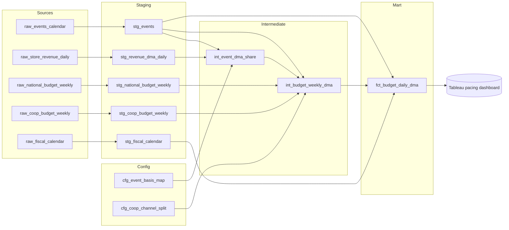

# Event Budget Pacing: Data Pipeline

BigQuery SQL pipeline that turns national and co-op media budgets into a **daily budget by DMA and channel**. It is the budget side of a Tableau spend pacing dashboard that compares actual spend to budget **by week, by month and across the whole event**, based on the days left in each period.

> Project, dataset and table names are generic placeholders (`your-project.marketing_analytics.raw_*`). Point them at your own sources before deploying.

## The problem

- **National budget** is planned by week and channel, with no DMA split.
- **Co-op budget** is planned by week and DMA, with no channel split.
- **Actual spend** comes in daily, by DMA and channel.

To compare spend to budget, both budgets have to be brought to the same grain as actuals (**date × DMA × channel**) without losing or double-counting a dollar.

## Approach

| Budget | How it is allocated |
|---|---|
| National | Split to DMAs by each DMA's share of store revenue in a **basis event** (by default the previous event; planners can override it). |
| Co-op | Already by DMA. Split to channels by a configurable split (currently 50% Meta / 50% YouTube). |
| Both | Weekly budget spread evenly across the in-event days of each week, so pacing works for any period. |

## Architecture



## Layers

| Layer | Rule | Models |
|---|---|---|
| **Config** | Small editable tables. Business rules live here, not in code. | `cfg_event_basis_map`, `cfg_coop_channel_split` |
| **Staging** | One view per source. Rename, reshape, clean (e.g. DMA names). No business logic. | `stg_events`, `stg_revenue_dma_daily`, `stg_national_budget_weekly`, `stg_coop_budget_weekly`, `stg_fiscal_calendar` |
| **Intermediate** | Business logic: revenue shares, allocation, channel split. | `int_event_dma_share`, `int_budget_weekly_dma` |
| **Mart** | Final dataset at a stated grain, ready for BI. | `fct_budget_daily_dma` |
| **Snapshot** | Optional: freezes DMA shares once an event starts. | `snap_event_dma_share` |

**Mart grain:** one row per `event_key × date × dma × budget_source × channel`.

## Key design decisions

- **Works for any event.** Every event in the calendar is processed in one pass. A new event (e.g. 2027) needs only data rows, with no SQL changes.
- **`event_key` (`year_event`, e.g. `2026_E5`)** is the unique event identifier. Event names repeat each year.
- **Long format** (one row per channel) matches the grain of actual spend, so Tableau joins budget to actuals on `date + dma + channel`.
- **Daily grain** handles weeks that cross month boundaries and makes "budget to date" a simple date filter.
- **Config in tables, not code.** The Co-op split supports per-event overrides, so changing it for a future event never rewrites past events.
- **Clean once, in staging.** DMA names are standardized in staging so every downstream join matches.
- **No rounding in SQL.** Formatting is left to Tableau, so channels always add up exactly to totals.

## Data quality tests

Each test in `tests/` returns the rows that **fail** the check. 0 rows = pass.

| Test | Protects against |
|---|---|
| `assert_budget_reconciles_to_source` | Any budget lost or duplicated anywhere in the pipeline (most important) |
| `assert_every_budgeted_event_has_dma_shares` | An event's whole National budget being dropped because it has no basis revenue |
| `assert_national_rows_match_one_event` | National rows dropped (typo/wrong dates) or double-counted |
| `assert_events_do_not_overlap` | Co-op weeks assigned to two events |
| `assert_dma_shares_sum_to_one` | Allocation not adding back up to the national total |
| `assert_coop_split_sums_to_one` | Co-op budget gained or lost in the channel split |
| `assert_fct_grain_is_unique` | Duplicate rows doubling budget in Tableau |
| `assert_fiscal_calendar_one_row_per_date` | Calendar duplicates fanning out budget |
| `assert_fct_has_fiscal_attributes` | Days missing from fiscal views |
| `warn_coop_dmas_without_revenue_share` | DMA name mismatches between sources (review only) |

## How to run

Requires the `bq` CLI, authenticated to the project.

```bash
./deploy.sh      # create config tables and views, in dependency order
./run_tests.sh   # run all tests; exits non-zero if any assert_ test fails
```

## Common tasks

**Add a new event (e.g. 2027 E1)**
1. Add it to `raw_events_calendar` with `event_key = '2027_E1'`.
2. Load its National weekly budget (event name `E1`) and Co-op budget.
3. Optional: choose its basis event in `cfg_event_basis_map`.
4. Run `./run_tests.sh`.

**Change the Co-op split for one event**
```sql
INSERT INTO `your-project.marketing_analytics.cfg_coop_channel_split`
VALUES ('2027_E2', 'Meta', 0.6), ('2027_E2', 'YouTube', 0.4);
```

**Freeze DMA shares once an event starts**
Run `snapshots/snap_event_dma_share.sql` (or schedule it), then point `int_budget_weekly_dma` at `snap_event_dma_share` instead of `int_event_dma_share`.

## Repository layout

```
event_budget_pipeline/
├── config/          editable rule tables
├── models/
│   ├── staging/     one clean view per source
│   ├── intermediate/business logic
│   └── marts/       Tableau data source
├── snapshots/       optional frozen shares
├── tests/           data quality checks
├── deploy.sh
└── run_tests.sh
```
